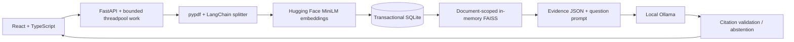
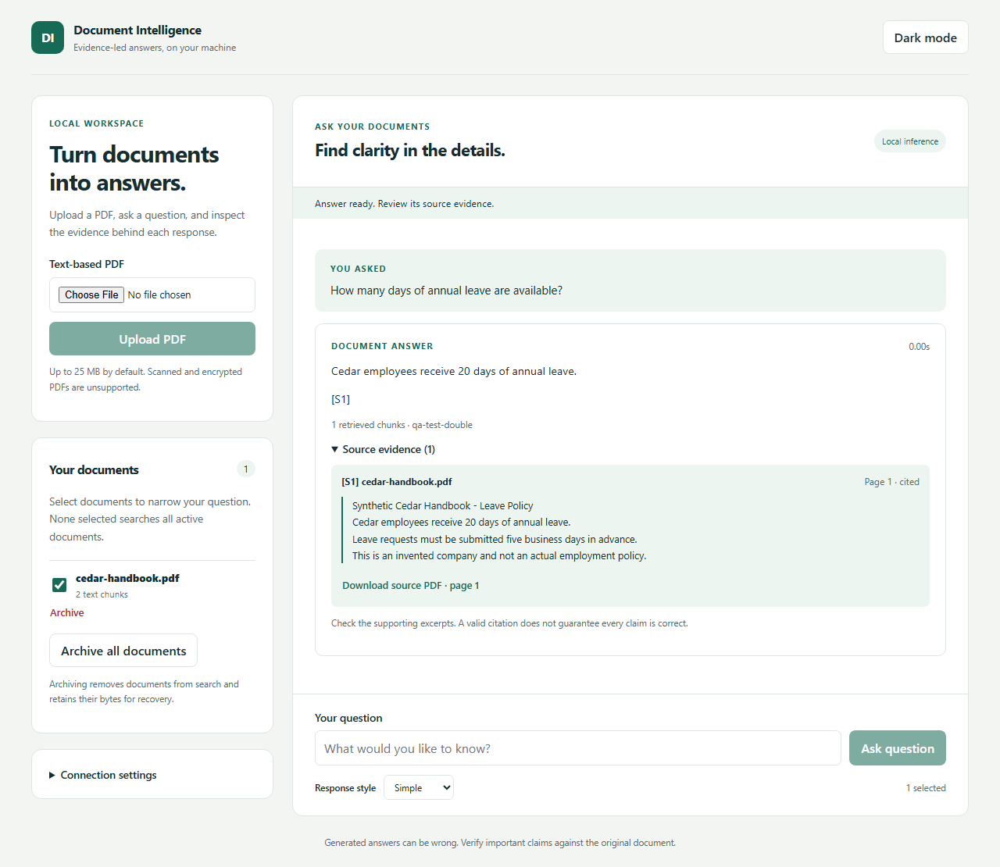

# AI Document Intelligence

A local, single-user PDF RAG application with a React/TypeScript interface, FastAPI backend,
Hugging Face embeddings, FAISS retrieval and Ollama generation. Answers expose original pages,
exact supporting excerpts and downloadable source PDFs. The application is a portfolio demo;
production operations and general answer accuracy are not claimed.

## What is implemented

- Text-PDF ingestion, validation, content-hash deduplication and page-preserving chunks.
- Transactional SQLite storage of PDF bytes, text and normalized vectors; no pickle loading.
- In-memory FAISS cosine retrieval, score filtering and document selection.
- Four answer styles, structured Ollama output, citation-ID validation and consistent abstention.
- Document listing, archive/reset with bytes retained, and source PDF retrieval.
- Responsive accessible controls, sanitized Markdown, dark mode, cancellation and overlap guards.
- Deterministic backend/component/browser tests, coverage gate and synthetic evaluation experiments.

No OCR, DOCX, conversational memory, agents, LangGraph, MCP or reranking is implemented.
The old private documents and FAISS index are preserved and not automatically imported.

## Local setup ? Windows

Use Python 3.11 and Node 22 for the documented/CI setup. Patched dependencies require Python
3.10 or newer. The full environment and a clean lightweight test environment were verified
locally on Python 3.11.17; the original Anaconda environment was left unchanged.
Ollama must already be installed; no hosted or paid API is required.

From the repository root:

```powershell
python -m venv .venv
.\.venv\Scripts\python.exe -m pip install -r requirements-dev.txt
ollama pull llama3
# If Ollama is not running, launch the app or run ollama serve separately.
.\.venv\Scripts\python.exe -m uvicorn backend.main:app --host 127.0.0.1 --port 8000
```

In a second terminal:

```powershell
Set-Location frontend
npm.cmd ci
npm.cmd run dev
```

Open <http://127.0.0.1:5173>. Upload `examples/cedar-handbook.pdf` and ask:
?How many days of annual leave do Cedar employees receive?? Inspect page 1 evidence and download
the original PDF. Upload `examples/harbor-support.pdf` to try document selection and scope isolation.
Select no documents to search all active documents. Each question is independent.

To build and preview the bundled UI:

```powershell
npm.cmd run build
npm.cmd run preview
```

Preview runs at <http://127.0.0.1:5500>. The original `frontend/app.js` and `frontend/style.css`
are retained but unused; the active entry is `frontend/src/main.tsx`.
The active project-local Python runtime is `.venv/Scripts/python.exe`.

## Configuration

See [.env.example](.env.example). Set variables in your shell before starting the process; no
`.env` loader is installed. Defaults use `backend/data/v2/`, MiniLM embeddings, `llama3`,
800-character chunks/100 overlap, top-k 3, and minimum cosine score 0.30.

```powershell
$env:ADI_DATA_DIR = "$PWD\backend\data\v2"
$env:OLLAMA_MODEL = "llama3"
$env:GENERATION_TIMEOUT = "120"
# Optional local authentication: set a generated secret only in your shell.
$env:ADI_API_TOKEN = "YOUR_LOCALLY_GENERATED_TOKEN"
```

Enter a configured token in the UI's Connection settings and reconnect. It remains in memory.
Frontend `VITE_API_URL` is configurable at build/dev startup. CSP permits local APIs only by default.
Never expose the API publicly or set a remote model URL without reviewing the data boundary.
Changing embedding model requires a fresh data directory and re-uploading documents.

## Verification

From the root with development dependencies installed:
For an exact verified Windows dependency snapshot, use `requirements-lock-windows-py311.txt`.
For deterministic CI without model libraries, use `requirements-test.txt`.

```powershell
.\.venv\Scripts\python.exe -m pytest --cov --cov-report=term-missing
.\.venv\Scripts\python.exe -m scripts.fixtures
.\.venv\Scripts\python.exe -m scripts.evaluate --mode deterministic --output docs/evaluation-deterministic.json
```

Frontend checks:

```powershell
Set-Location frontend
npm.cmd test
npm.cmd run build
npx.cmd playwright install chromium
npm.cmd run test:browser
```

Browser QA starts its own backend at port 8010, uses deterministic model doubles and synthetic PDFs,
and checks upload/query/archive/reset, failures, cancellation, source downloads, mobile overflow and
axe accessibility in light/dark themes. Ports 8010 and 5173 must be available. It never opens private
corpus files. Screenshots contain only synthetic content. Python CI covers active backend code and Python utility scripts. Three unchanged, unintegrated
legacy backend helpers are excluded. The overall statement-coverage gate is 90%; active-backend
coverage reached 100%.

Opt-in real-model checks require a running Ollama server and cached embeddings:

```powershell
$env:RUN_LOCAL_E2E = "1"
$env:HF_HUB_OFFLINE = "1"
.\.venv\Scripts\python.exe -m pytest tests/test_local_e2e.py -v
.\.venv\Scripts\python.exe -m scripts.evaluate --mode real --output docs/evaluation-results.json
```

Without `HF_HUB_OFFLINE=1`, a missing embedding model may be downloaded from Hugging Face.
Evaluation always creates an isolated synthetic store under ignored `.local/evaluation/`.
See [methodology and measured results](docs/evaluation.md); deterministic scores are not real-model accuracy.

## Architecture



[Detailed architecture decisions](docs/architecture.md) ? [API contract](docs/api.md) ?
[Specification and acceptance evidence](docs/specification.md)

## Data safety and limitations

Original personal documents, indexes and ignored backups must never be published. The new storage
does not load the old pickle. Archive/reset removes documents from search and retains their bytes;
it is not privacy erasure. Local storage is plaintext. CORS is not authentication. Without a configured
token, localhost clients can access the active corpus. Citation checks validate IDs and expose evidence;
they do not guarantee every generated claim is entailed. Prompt injection remains a risk.

Read [security and recovery](docs/security.md) and [publication checklist](docs/publication-checklist.md).
The repository is intended to remain private during development. No public hosting or PR is configured. Choose a license before any public release.

## Troubleshooting

- Backend connection/token errors: check port 8000, configured token, CORS origin and UI connection settings.
- Embedding initialization errors: cache MiniLM, allow its first download, or check offline-mode configuration.
- Ollama errors: run `ollama list`, check service availability and `OLLAMA_MODEL`. Generation has a finite timeout.
- PDFs without text or encrypted PDFs: unsupported; use a text-based unencrypted PDF.
- Model mismatch: select a fresh `ADI_DATA_DIR` and re-upload; original records remain intact.
- Capacity 429: retry after active work finishes. Client cancellation may leave server work running.
- Cold starts: model initialization and CPU inference can take time; measured latency is reported per response.

## Portfolio artifacts

[Interview guide](docs/interview-guide.md) ? [Resume evidence](docs/resume-evidence.md) ?
[Verification report](docs/verification.md)



The mobile dark-theme example is in [docs/screenshots](docs/screenshots/).

