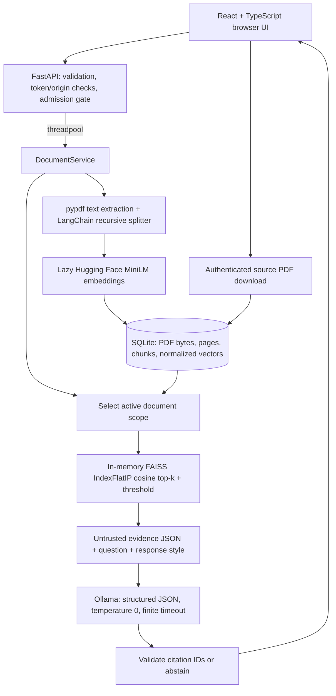

# Architecture and decisions

## Storage decision

SQLite is the only persisted authority. A transaction contains the PDF, chunks and embeddings;
failed writes roll back together. WAL and `BEGIN IMMEDIATE` coordinate writers across processes.
Raw float32 vectors cannot execute Python code. FAISS is rebuilt from a read snapshot for each
query, using only the selected active documents. This avoids persisted index/metadata mismatch
and pickle deserialization at the cost of O(ND) rebuild work and memory per request. It is suited
to a small local corpus; a large corpus needs a versioned index cache or a managed vector store.
No persisted FAISS binary is read, including the original legacy index.

PDF content hashes prevent duplicate records even if two workers race. Duplicate requests may
still do redundant embedding computation before the winning transaction commits. The embedding
model ID is stored; mismatch fails closed. A model ID is not a checksum of model weights, so use
a fresh store if cached weights or encoding settings change. Archived bytes remain recoverable.
Read transactions provide a snapshot: archiving after retrieval may make a later source download
return 404, while an in-flight answer can still reference its earlier snapshot.

## Concurrency decision

Async routes delegate blocking work to Starlette's threadpool. A bounded semaphore rejects excess
work with 429 rather than accepting an unbounded queue. Cancellation keeps the worker's capacity
occupied until it exits, and a callback consumes background exceptions. Browser cancellation
does not terminate a CPU task or an Ollama request already running. The Ollama adapter has a
connect timeout and read timeout, not a hard total deadline against a malicious trickle response.
Embedding initialization/inference is serialized per process to protect the lazy model instance.
SQLite's write timeout is 10 seconds. CPU/PDF hard time limits need separate worker processes.

FastAPI explains the distinction between blocking and async handlers in its
[concurrency documentation](https://fastapi.tiangolo.com/async/).

## Retrieval and grounding decision

Vectors and questions are normalized; FAISS inner product therefore measures cosine similarity.
See [FAISS metric documentation](https://github.com/facebookresearch/faiss/wiki/MetricType-and-distances).
Default chunks are 800 characters with 100 overlap; top-k is 3 and minimum cosine score is 0.30.
These are tunable demonstration defaults, not generally calibrated relevance guarantees.
One-based page numbers and deterministic hash/index chunk IDs survive persistence.

The prompt serializes question/evidence as JSON and marks both untrusted. The model must return
`answer`, `citations`, and `insufficient_evidence`. Only nonempty answers with provided citation
IDs are accepted. Invalid/missing citations and declared insufficient evidence produce the same
abstention message. The UI exposes exact retrieved text and marks which excerpts were cited.
This validates references, not every claim in the generated answer. No agent or tool execution
is available. LangChain is used for splitting and Hugging Face integration; orchestration is Python.

## Frontend decision

The migration is incremental: retain the original upload/query endpoints and four response styles,
replace the static entry with React/TypeScript/Vite, and separate document, evidence and request
responsibilities. No UI framework is used. Original `frontend/app.js` and `frontend/style.css` remain
as unused legacy artifacts to respect the no-deletion requirement; `index.html` now loads `src/`.
Sanitized Markdown uses bundled dependencies, a tag/attribute allowlist and no remote images.
CSP allows only local API connections by default; changing to a remote API also requires CSP review.
The synchronous ref guard prevents duplicate submits before React rerenders. The UI stores only
the theme; tokens and questions remain in memory. Source PDFs are downloaded with authenticated
fetch rather than embedding tokens in links. Full PDF downloads retain page numbers in evidence.

Development CSP permits Vite-injected styles and its refresh preamble only during `vite serve`.
The production build keeps strict self-hosted script/style rules. Vite filesystem access is scoped
to the frontend directory and denies secret files. Browser QA asserts styled rendering, not only DOM content.
